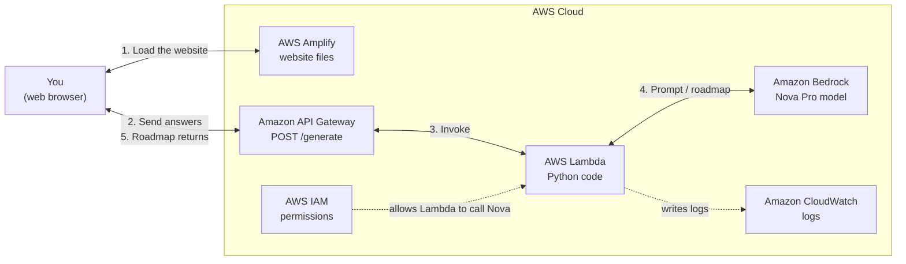

# AI STEM Career Navigator

A beginner-friendly generative-AI app on AWS. A user enters a career goal, experience level, interests and weekly study hours, and Amazon Bedrock (Amazon Nova) generates a personalized roadmap with skills, certifications, portfolio projects, and a 90-day plan.

**Architecture:** HTML/CSS/JS → API Gateway (HTTP API, `POST /generate`) → AWS Lambda (Python) → Amazon Bedrock (Nova Pro)

| Path | What it is |
|---|---|
| `MANUAL_SETUP_GUIDE.md` | **Start here:** step-by-step AWS Console guide to build and deploy the app by hand |
| `WORKSHOP_GUIDE.md` | 45-minute facilitator script (timing, talking points, troubleshooting) |
| `presentation/` | 20-slide workshop intro deck with speaker notes: what the cloud is, what AI is, why this project, a slide explaining each AWS service (Amplify, API Gateway, Lambda, Bedrock, IAM, CloudWatch), and an architecture workflow diagram. [View PDF](presentation/AI_Career_Coach_Workshop.pdf) · [Download PPTX](presentation/AI_Career_Coach_Workshop.pptx) (opens in PowerPoint or Google Slides) |
| `lambda/lambda_function.py` | Lambda handler: builds the prompt, calls Bedrock `converse`, returns JSON |
| `lambda/test-event.json` | Lambda console test event |
| `setup/bedrock-invoke-policy.json` | Least-privilege IAM policy for the Lambda role |
| `frontend/` | Static site: set `API_URL` in `app.js`, then open `index.html` or deploy to Amplify |

Lambda settings: Python 3.12+, timeout **30 s**, optional env var `MODEL_ID` (default `us.amazon.nova-pro-v1:0`).

## Quick start

Follow **[MANUAL_SETUP_GUIDE.md](MANUAL_SETUP_GUIDE.md)**: Bedrock → Lambda → API Gateway → frontend → Amplify, then clean up.
